# University Hostel Management System — Prestige Academic Edition

[](https://dotnet.microsoft.com/)
[](https://learn.microsoft.com/en-us/dotnet/desktop/winforms/)
[](https://www.microsoft.com/sql-server/)
[](https://learn.microsoft.com/en-us/dotnet/framework/data/adonet/)
[](#)

A production-grade, enterprise desktop software application designed for university accommodation offices and bursaries. The system manages student residential accommodation strictly at the individual **BED** level with per-semester rate freezing, duplicate conflict safeguards, partial payment tracking, check-in/out clearance inspections, and immutable activity auditing.

---

## 🏛️ System Architecture & Layered Design

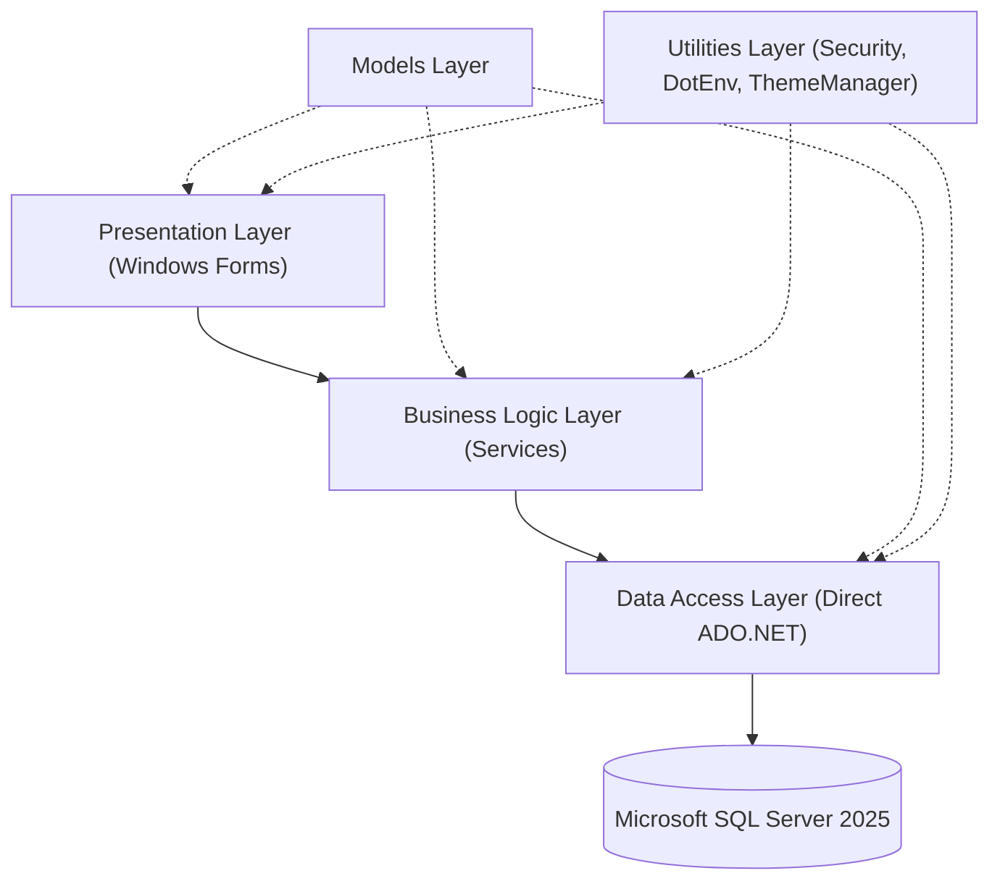

- **Presentation Layer (`Forms/`, `Controls/Views/`)**:
  - Executive Dashboard with 4 real-time calculated KPI cards and occupancy distribution meters.
  - Dedicated operational modules: Hostels, Rooms, Bed Matrix, Student Directory, Bed Allocations, and Bursar Billing Ledger.
  - Custom modals with input validation, key handover checklists, rate differential calculators, and receipt print preview.
- **Business Logic Layer (`Services/`)**:
  - `AuthenticationService`: PBKDF2 password verification with brute-force lockout protection.
  - Allocation rules: strictly validates available bed state, semester allocation windows, and duplicate allocation prevention.
- **Data Access Layer (`Data/Repositories/`)**:
  - Direct ADO.NET (`Microsoft.Data.SqlClient`) using parameterized commands, `SqlTransaction` boundaries, and no ORM overhead.
- **Models Layer (`Models/`)**:
  - Strongly typed entities: `Student`, `Hostel`, `Room`, `Bed`, `BedAllocation`, `Payment`, `Semester`, `User`, and `DashboardStatistics`.
- **Design System (`Helpers/ThemeManager.vb`)**:
  - Governed by Anthropic's `frontend-design` institutional tokens: Oxford Navy (`#0B192C` to `#1E3E62`), Academic Gold (`#D97706`), Ceramic Slate (`#F8FAFC`), and Pristine White (`#FFFFFF`).

---

## 📸 Interface Screenshots

| Screen | View |
|---|---|
| **Executive Dashboard** | 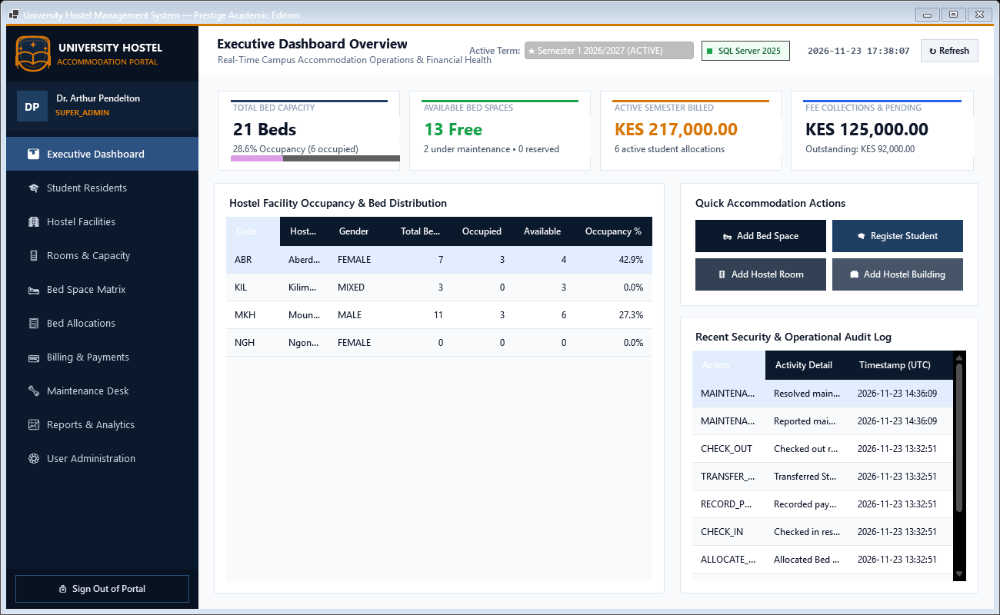 |
| **Bed Space Matrix** | 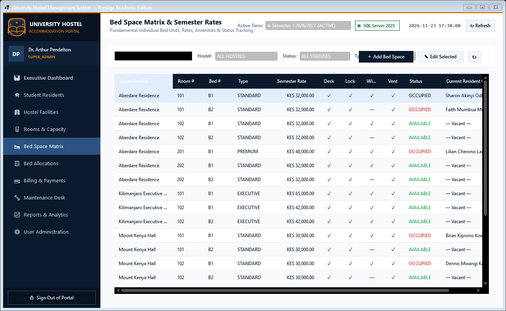 |
| **Bed Allocations Desk** | 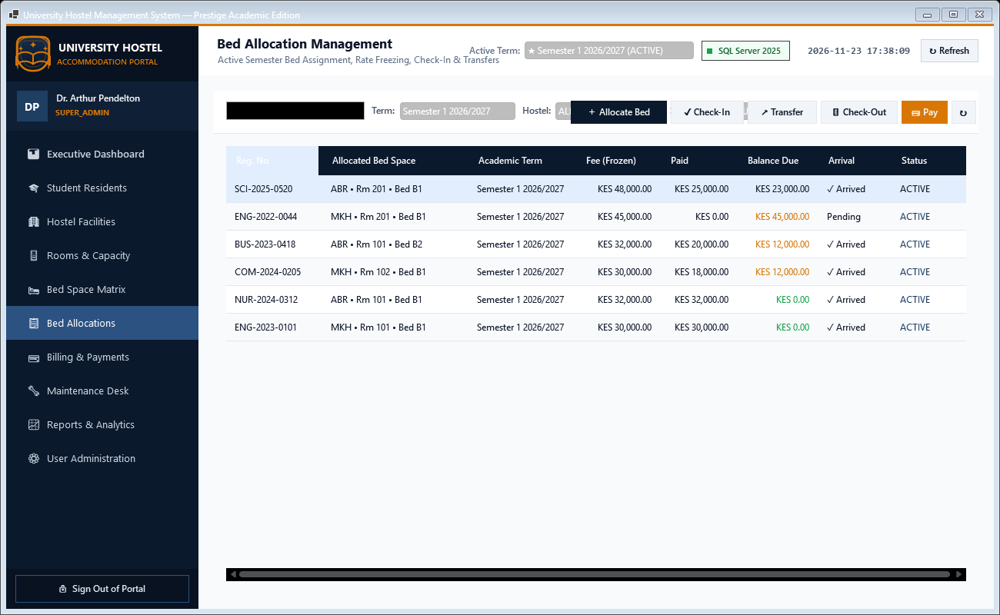 |
| **Bursar Financial Ledger** | 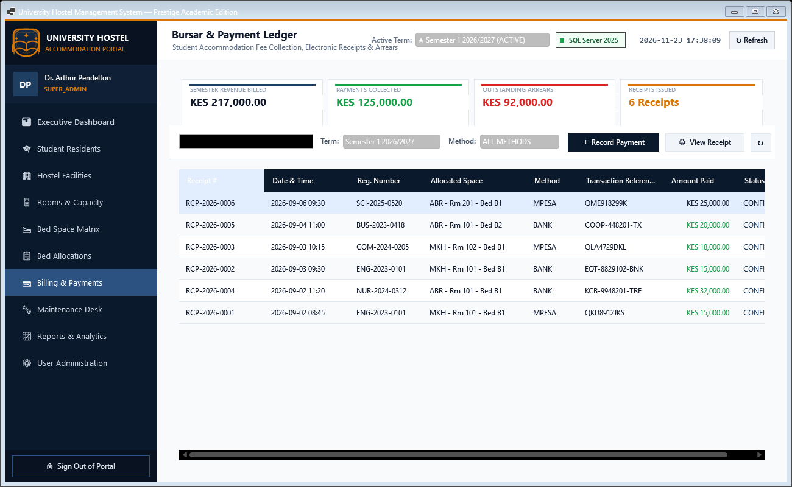 |
| **Hostel Maintenance Incident Desk** | 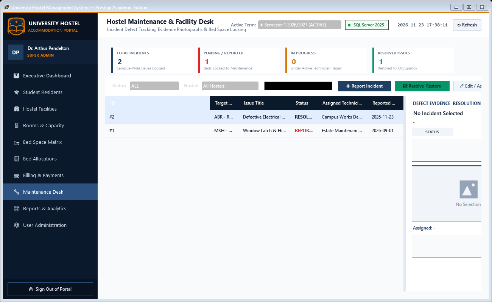 |
| **Institutional Reports & Analytics** | 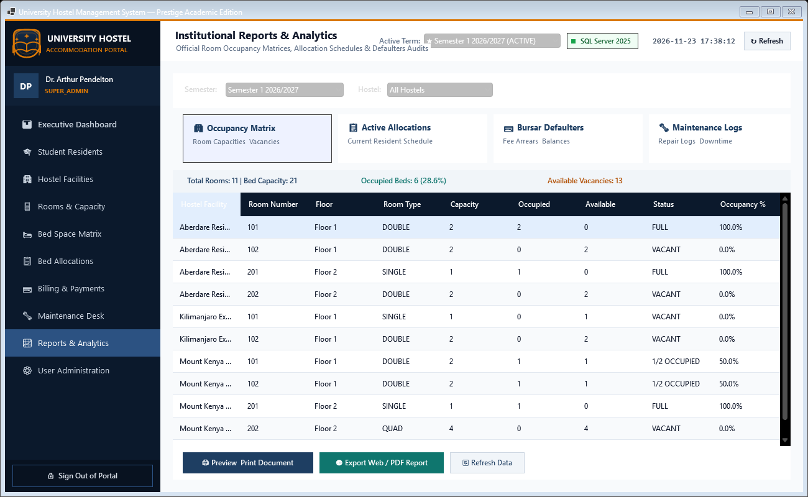 |
| **Staff Administration & RBAC Vault** | 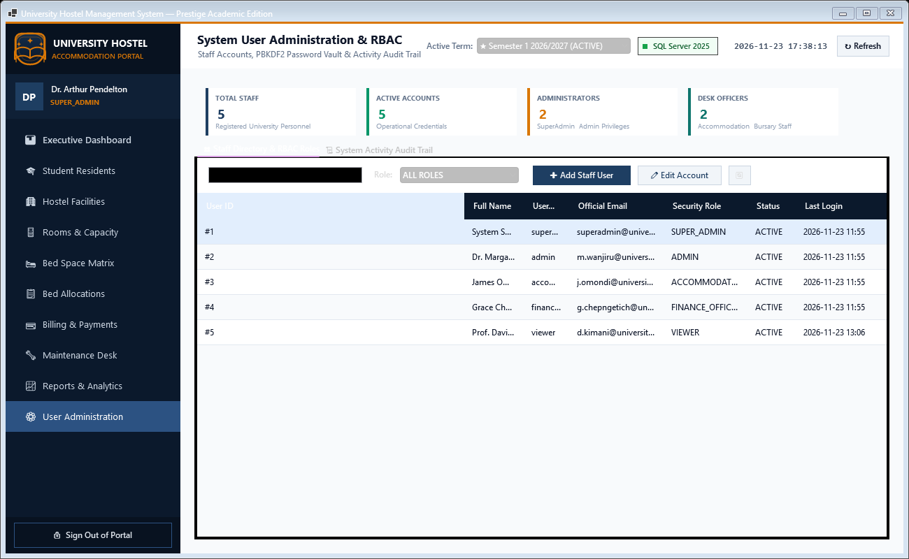 |
| **Room Photograph Gallery** | 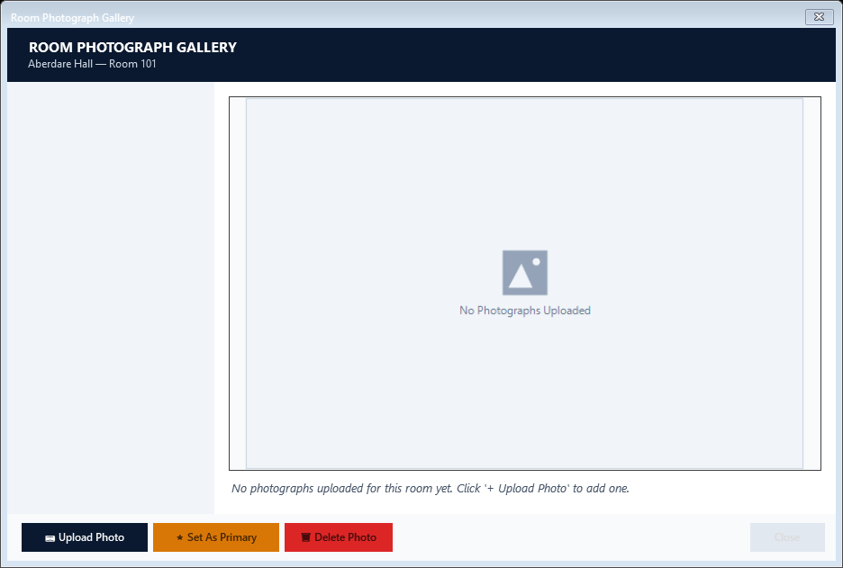 |
| **Official Electronic Receipt** | 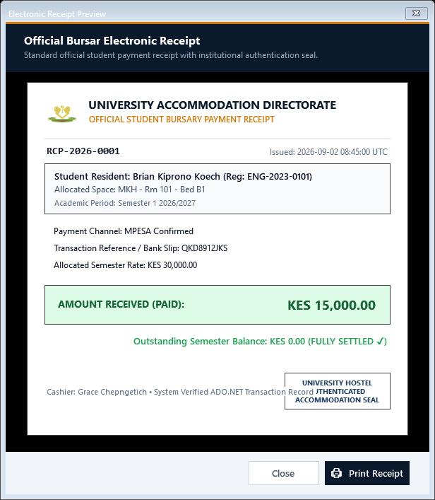 |
| **Student Directory** | 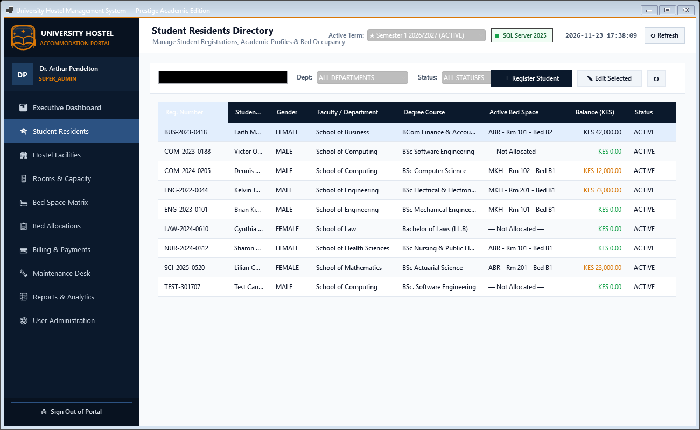 |
| **Login Vault** | 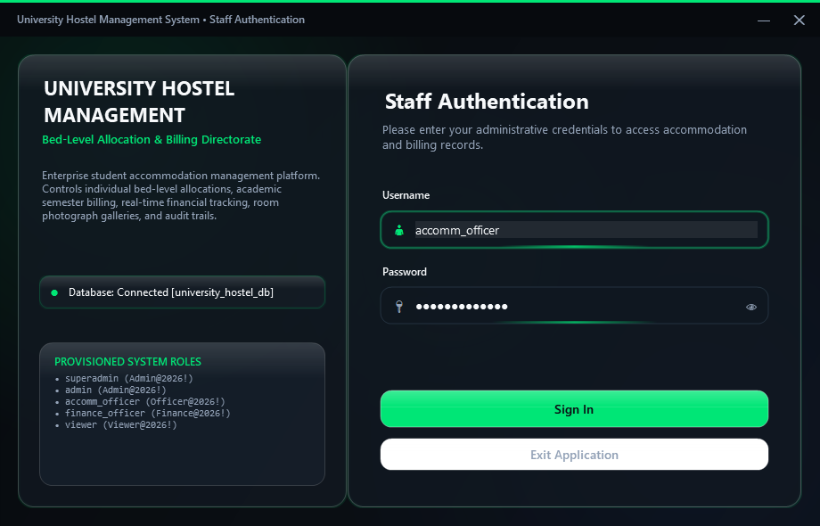 |
| **Diagnostic Splash Screen** | 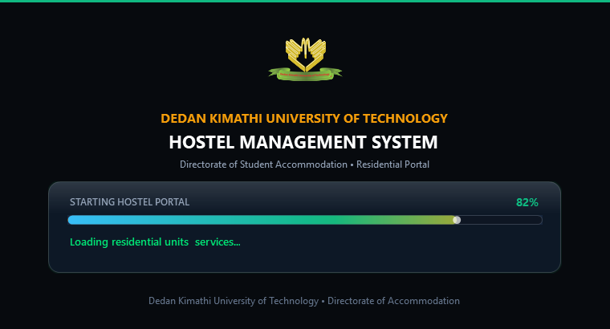 |

---

## ⚙️ Core Domain Business Rules

1. **Individual Bed Primacy**: Accommodation is inventoried, managed, and billed strictly at the **BED** space level rather than the room level.
2. **Permanent Rate Snapshotting**: When a bed is allocated to a student, the bed's active `semester_rate` is frozen into `dbo.bed_allocations.semester_fee`. Future price changes never recalculate historical fees.
3. **Database Uniqueness & Conflict Safeguards**:
   - `UQ_active_bed_per_semester`: Enforces that two students cannot occupy the same bed in the same academic semester.
   - `UQ_active_student_per_semester`: Enforces that one student cannot hold multiple active bed spaces in the same semester.
   - Bed status strictly transitions: `AVAILABLE` ➔ `OCCUPIED` ➔ `CHECKED_OUT` (or `TRANSFERRED`).
4. **Maintenance Desk & Automatic Bed Locking**:
   - When an incident is reported on a bed, the bed's status is transactionally updated to `MAINTENANCE`.
   - Database triggers enforce that any allocation attempted on a `MAINTENANCE` bed is rejected immediately.
   - Upon incident resolution and technician sign-off, the bed space can be automatically restored to `AVAILABLE`.
5. **Physical Asset Management Pipeline**:
   - High-resolution room photographs and repair evidence are managed on disk under `Assets/rooms/` and `Assets/maintenance/`.
   - Metadata and relative paths are stored in `dbo.room_images` with transactional primary photo assignment.
   - Images are loaded via in-memory stream buffers to eliminate GDI+ OS file locking issues.
6. **Institutional Reporting & Export Engine**:
   - Four specialized analytical reports: Room Occupancy Schedule, Resident Allocation Ledger, Fee Collection & Arrears Schedule, and Facility Defaulters/Maintenance Register.
   - Features standard `PrintDocument` high-resolution vector rendering with zoomable preview modal and standalone printable HTML export bearing the University Accommodation Board crest.
7. **Staff Administration & Role-Based Access Control (RBAC)**:
   - 5 Granular Roles: `SUPER_ADMIN`, `ADMIN`, `ACCOMMODATION_OFFICER`, `FINANCE_OFFICER`, and `VIEWER`.
   - Enterprise PBKDF2-SHA256 password security with random salt generation.
   - Immutable system audit trail in `dbo.activity_logs` recording user actions, IP addresses, entity references, and change descriptions.

---

## 🚀 Setup & Execution

### Prerequisites
- Microsoft SQL Server 2022 / 2025 running locally (or remote instance).
- .NET 8.0 or .NET 11.0 Windows Desktop SDK.

### Database Deployment
1. Run the database migration script via `sqlcmd`:
   ```powershell
   sqlcmd -S localhost -E -i database\create_database.sql -C
   ```
2. Copy environment template and configure connection:
   ```powershell
   copy .env.example .env
   ```

### Diagnostic Test Runners
The application includes integrated CLI diagnostic suites to verify database constraints, transactions, and UI handles:

```powershell
# Phase 1 & 2: Database connectivity, PBKDF2 hashing & Authentication
dotnet run --no-build -- --test-auth

# Phase 3: Core management modules & live dashboard KPI calculations
dotnet run --no-build -- --test-dashboard

# Phase 4: Bed allocations, rate snapshotting, check-in, transfers & billing ledger
dotnet run --no-build -- --test-phase4

# Phase 5: Room photograph assets, maintenance bed locking, reporting & RBAC audit trail
dotnet run --no-build -- --test-phase5

# Render and capture UI screen previews
dotnet run --no-build -- --capture-screens
```

### Launching the Application
```powershell
dotnet run
```
Default Administrator Login:
- **Username**: `superadmin`
- **Password**: `Admin@2026!`

---

## 👥 Authors
- **Group 4 Software Engineering Team** — University Hostel Management System
